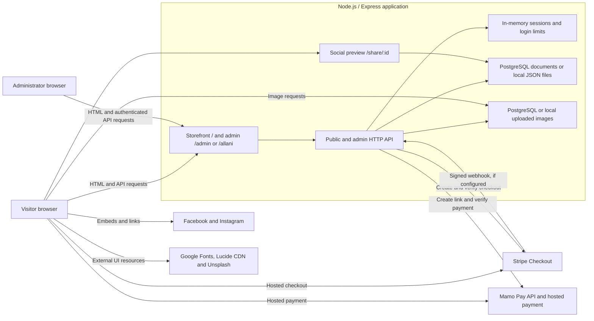
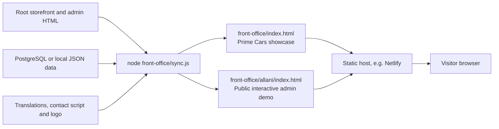
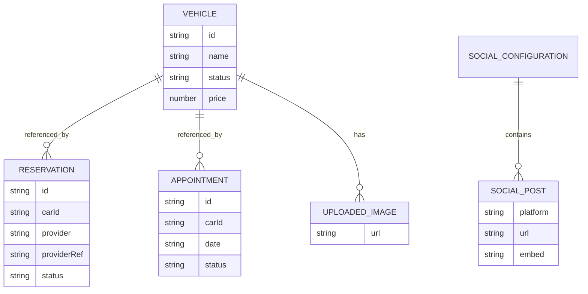

# Architecture diagrams

These Mermaid diagrams represent the current code. See
[architecture.md](architecture.md) for details and operational limitations.

## Runtime and external systems



On the Node server, `/allani` uses the same authenticated APIs as `/admin`.
The generated `front-office/allani/` remains a separate interactive static demo.

## Static generation and publishing



Publishing only the generated storefront omits the admin snapshot. Publishing
the entire `front-office` directory includes it. Data changes require
regeneration and redeployment; external assets and any referenced uploaded
images must remain accessible. The static storefront has no deposit checkout.

## Reservation and payment

```mermaid
sequenceDiagram
    actor Customer
    participant Browser
    participant Server as Express server
    participant Data as PostgreSQL or local JSON files
    participant Provider as Stripe or Mamo

    Customer->>Browser: Choose vehicle and enter contact details
    Browser->>Server: POST /api/reserve
    Server->>Data: Check vehicle and create pending hold
    Server->>Provider: Create hosted checkout or payment link
    Provider-->>Server: Provider reference and checkout URL
    Server->>Data: Save provider reference and checkout URL
    Server-->>Browser: Checkout URL
    Browser->>Provider: Redirect to hosted checkout
    Customer->>Provider: Complete payment
    Provider-->>Browser: Return to vehicle page
    Browser->>Server: POST /api/reserve/confirm
    Server->>Provider: Retrieve payment status
    Provider-->>Server: Verified status
    opt Stripe webhook configured
        Provider->>Server: Signed checkout.session.completed webhook
    end
    Note over Server,Data: On verified paid status, match provider reference.
    Server->>Data: Mark reservation paid; reserve available vehicle
    Server-->>Browser: Confirmation result
```

The webhook is an alternative Stripe confirmation path and may arrive before
or after the browser return. Mamo is verified through the return flow. Pending
holds last 30 minutes for the application's blocking check, without
automatically updating the pending record's status.

## Data relationships



These are logical references within JSON documents, not database-enforced
foreign keys. Vehicles may also use external image identifiers rather than
uploaded files.
